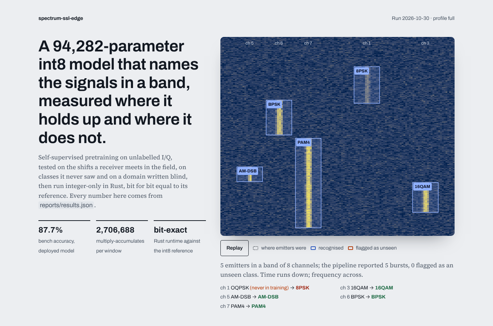

# spectrum-ssl-edge

Self-supervised recognition of radio signals: the model is tested under the shifts a field receiver
meets, checked on classes it never saw, and run integer-only on small hardware.

A 94k-parameter 1-D ResNet learns from unlabelled I/Q with contrastive pretraining, is fine-tuned on
a few labelled bench windows, and is then tested where it will be used:
- through multipath and cheaper hardware;
- at symbol rates the bench never recorded;
- on bursty captures with dropped samples;
- on a domain written blind by someone who never saw the code.

The same model is quantised to int8 and run by a dependency-free Rust runtime that matches the integer
reference bit for bit. It also sits behind a wideband detector that finds bursts in a band,
channelises them and classifies them.

The questions are research questions, and the answers are reported whichever way they came out
(`docs/REPORT.md`, generated). The application is civil spectrum monitoring: communications waveforms
in a channel grid ([ADR 5](docs/adr/0005-scope.md)).



## What it found

All numbers are from the committed full run (`reports/results.json`), as means over 3 seeds.
Each test domain has 3,000 windows. The 10 classes are BPSK, QPSK, 8PSK, 16QAM, 64QAM, PAM4, GFSK,
AM-DSB, WBFM and OFDM.

| | Result |
|---|---|
| **Few labels** | With 10 labels per class, pretraining then fine-tuning reaches 76.4% on the bench against 71.1% from scratch. With 1,000 labels per class the gap shrinks to +1.4 pts (88.5% vs 87.1%). On the blind held-out domain at 10 labels: 45.1% (field pretraining, linear probe) against 33.4%. |
| **Shift** | Bench 87.7% falls to 76.3% under multipath, 83.5% with cheaper hardware and 76.3% at unseen symbol rates. On bursts with dropouts it falls to 36–49%, and on the blind domain to 41–47%. Pretraining on unlabelled field data adds only +1.9 pts on the shifts it saw and +1.7 pts on those it did not. |
| **A finding we did not expect** | On bursty captures and on the blind domain, the *frozen* pretrained encoder with a linear probe beats the fine-tuned one: 47.0% vs 38.7% and 46.7% vs 42.8%. Fine-tuning on clean bench labels gives back robustness the pretraining had learned. |
| **Calibration (replicating Ovadia et al., 2019)** | A temperature fitted on the bench gives 1.7% ECE there and does not transfer: 5.8–10.0% under moderate shift, 38–48% on bursts and the blind domain. A 3-model ensemble halves the error under moderate shift (hardware: 3.0% vs 6.7%). No method stays calibrated on the hardest shifts. |
| **Unseen classes** | Max-softmax and energy scores rank far-unseen classes (chirp spread spectrum, a CW tone) as *more* familiar than known ones (AUROC 0.39–0.45). Mahalanobis distance in the embedding reaches 0.895. Near-unseen classes (OQPSK, 32QAM) top out at 0.78. |
| **Edge** | 2.71 M multiply-accumulates and 95.7 KB of weights per 256-sample window. int8 bench accuracy is 87.9% against 87.5% in float, with 99.1% the same top-1. The Rust runtime is bit-exact with the numpy int8 reference on 1,200 of 1,200 windows from every domain. |
| **Scenes** | All 188 emitters are found on the bench, with 0 false detections. Each burst is classified by the int8 model. Unseen emitters are flagged 44% of the time, at a cost of 8.7% of known emitters wrongly flagged. Under multipath the wrongly-flagged rate rises to 32%: the bench threshold does not survive shift either. |
| **Blind held-out domain** | Deployed model 42.8%, supervised 40.9%. The first run is recorded in `reports/heldout/first_run.json` and is never rewritten. |

What did not reach its target:
- **Bench accuracy at SNR ≥ 12 dB is 91.7%, against a 95% target.** QPSK/8PSK and 16QAM/64QAM still get confused when there is a frequency offset.
- **Far-unseen AUROC is 0.895, against 0.90.** The release gate (`config/release.yaml`) reports both targets as missed and enforces regression floors instead. The targets were not lowered.
- **The Rust runtime is slower than ONNX Runtime on this x86 CPU** (0.94 ms per window against 0.12 ms float and 0.15 ms QDQ int8, one thread). Its point is a portable, auditable integer path with no dependencies, not speed against oneDNN's SIMD kernels.

## How it works

```
signals/   modulations -> PA (Rapp) -> multipath (Rician) -> LO offset, phase noise -> noise -> IQ imbalance, DC
           -> bursts, dropouts, short captures            (a domain = ranges; each window draws its own)
models/    1-D ResNet, masked mean+max pooling, 94k parameters, 2.7 M MACs per window
train/     SimCLR with RF augmentations (phase, CFO, crop, noise, dropout); probe or fine-tune; fixed schedules
evaluate/  label efficiency, accuracy by SNR, ECE/NLL/Brier, temperature scaling, ensembles,
           risk-coverage, open-set (MSP, energy, Mahalanobis, kNN), held-out first run, report, release gate
edge/      fold BN -> calibrate -> int8 (per-channel weights, integer requantisation) -> SSEQ file
           numpy int8 reference  ==  Rust runtime (bit-exact)      ONNX Runtime float and QDQ int8 alongside
detect/    wideband scene: spectrogram -> channel energy with hysteresis -> mix, filter, decimate
           -> int8 classification per window -> Mahalanobis novelty on the int8 embedding
edge-rs/   Rust: model parser, integer runtime (no deps, no allocation per window), FFT, channel energy, CLI
web/       results explorer: React 19, Vite, Motion; reads reports/results.json, computes nothing
```

Decisions are recorded in `docs/adr/`:
1. simulated signals as distributions;
2. contrastive pretraining with fixed schedules and no selection on test domains;
3. integer-only inference, bit-exact in Rust;
4. the blind held-out domain;
5. scope;
6. why channel energy with hysteresis replaced CA-CFAR.

## Run it

Python 3.11+, a Rust toolchain for the edge runtime, Node 22 for the explorer.

```bash
pip install -e ".[dev]"            # CPU PyTorch is enough
sse all --profile quick            # every step in minutes; the numbers mean nothing
sse all                            # the committed run: about 30 min of training on 2 cores, then edge and report
pytest -m "not slow"               # signals, metrics, int8, Rust parity, scenes, protocol (about a minute)
pytest -m slow                     # the quick profile end to end
cd edge-rs && cargo test --release # bit-exact parity and the spectrum front end on committed fixtures
cargo run --release -- bench tests/fixtures/model.bin tests/fixtures/vectors.bin
cd web && npm ci && npm run dev    # the explorer on the committed results
```

| Command | What it does |
|---|---|
| `sse run` | Builds the data, trains every model (5 methods × 3 label budgets × 3 seeds, 2 pretrained encoders), evaluates. |
| `sse edge` | Folds and quantises the deployed model, checks PyTorch = folded float, int8 vs float, Rust = int8 reference, and ONNX. Times them, runs the wideband scenes, writes the Rust fixtures. |
| `sse report` | Writes `reports/results.json` and `docs/REPORT.md`, and records the held-out first run once. |
| `sse gate` | Checks the floors in `config/release.yaml` and reports the targets. |

CI (`.github/workflows/ci.yml`) runs four jobs:
- **python:** ruff, the unit tests and the gate on the committed run;
- **pipeline:** the quick profile end to end;
- **rust:** fmt, clippy `-D warnings`, the parity tests and a benchmark;
- **web:** Biome, Vitest, build, and Playwright with axe on desktop and phone.

## Limits

- **Simulated, not recorded.** Results transfer to real receivers only as far as the simulator is
  right. The next step with real data would be to fit domain ranges to recordings and rerun the same
  questions.
- **Latency is measured on a CI-class x86 CPU, not on embedded hardware.** The numbers compare
  implementations, not platforms. The runtime is integer-only and allocation-free so that it can move
  to a microcontroller or DSP; that has not been done here.
- **The comparisons are fair but untuned.** Every method gets the same fixed schedule. A method that
  would win with its own tuning may lose here.
- **Small model, small data.** These are chosen for a two-core machine: 10,000 labelled and 48,000
  unlabelled windows. The probe-beats-fine-tune finding should be rechecked at larger scale before
  anyone relies on it.
